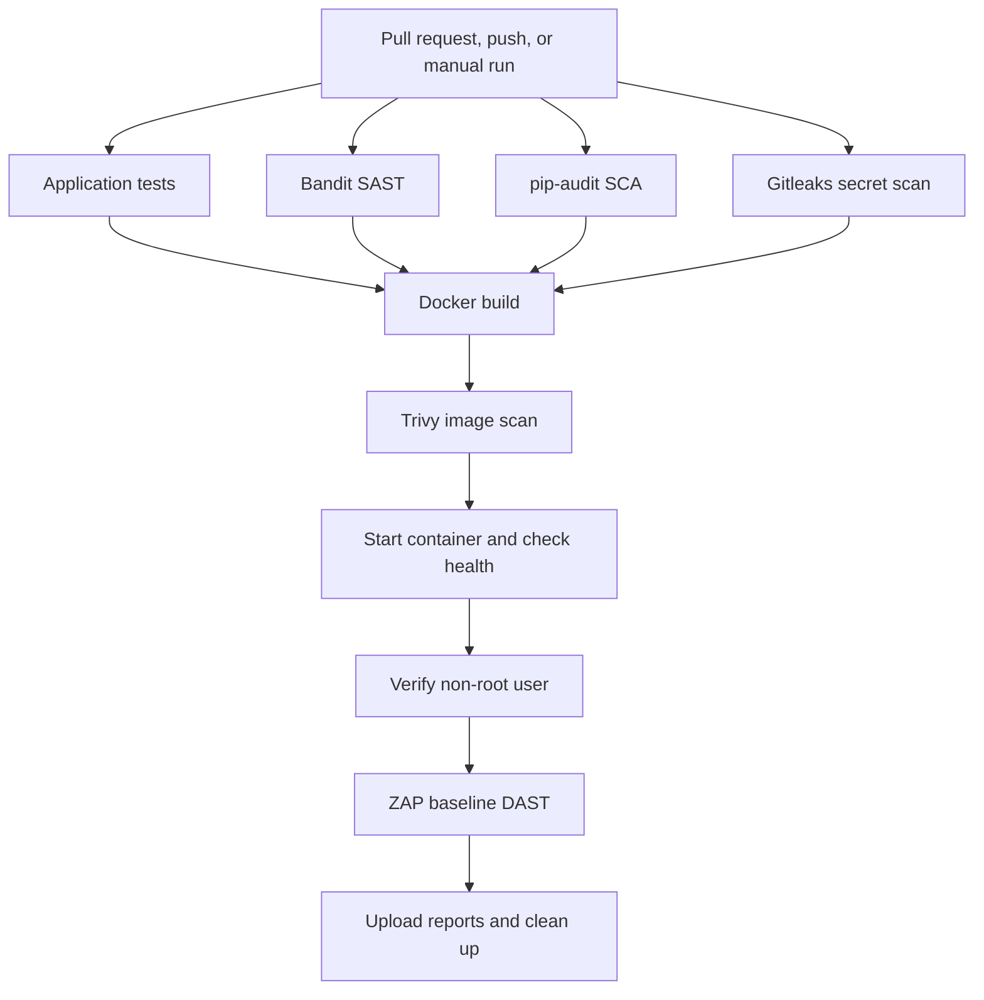

# SecureShip

[](https://github.com/0xploitNinja/secureship/actions/workflows/ci.yml)

A Flask API demonstrating security checks in GitHub Actions. The pipeline tests the application, scans source code and dependencies, checks Git history for secrets, builds a Docker image, and scans the running application.

Built as a hands-on project to learn CI/CD security.

## Pipeline flow

Pull requests targeting `main`, pushes to `main`, and manual runs trigger the workflow.



The Docker job requires all four initial jobs to pass. Report upload and container cleanup run even when an earlier step fails.

## Security checks

| Check | Tool | Purpose | Pipeline behavior |
|---|---|---|---|
| Application tests | unittest | Verify the health endpoint's status and JSON response | Blocking |
| SAST | Bandit | Detect potentially unsafe Python code patterns | Blocking |
| SCA | pip-audit | Check application dependencies for known vulnerabilities | Blocking |
| Secret scanning | Gitleaks | Search Git history for potential secrets | Blocking |
| Container scanning | Trivy | Check image packages for HIGH and CRITICAL vulnerabilities | Reporting only |
| DAST | ZAP baseline | Crawl the running application and passively examine responses | Blocking according to scan configuration |

Trivy findings do not fail the job because its vulnerability exit code is set to `0`. Scanner execution errors still fail the step.

## Application

| Endpoint | Response |
|---|---|
| `GET /` | Service name and health endpoint location |
| `GET /health` | `{"status":"ok"}` |

The application adds these response headers.

- `X-Content-Type-Options`
- `Content-Security-Policy`
- `Permissions-Policy`
- `Cross-Origin-Resource-Policy`
- `Cache-Control`

The restrictive header settings suit this small demonstration API. Applications serving browser content may need different policies.

## Run locally

Requirements.

- Python 3.13.
- Docker.
- Git.

Clone the repository and install application dependencies.

```bash
git clone https://github.com/0xploitNinja/secureship.git
cd secureship

python3 -m venv .venv
source .venv/bin/activate
python -m pip install -r requirements.txt
```

Start the application.

```bash
python -m flask --app app run --host 127.0.0.1 --port 8000
```

In another terminal, check its health.

```bash
curl -i http://127.0.0.1:8000/health
```

## Run tests and source checks

With the virtual environment activated.

```bash
python -m pip install -r requirements-dev.txt

python -m unittest discover -s tests -v
python -m bandit -r app
python -m pip_audit -r requirements.txt --strict
```

## Run with Docker

Stop any application already using port `8000`, then build and start the container.

```bash
docker build -t secureship:local .

docker run -d \
  --name secureship-api \
  -p 127.0.0.1:8000:8000 \
  secureship:local
```

Verify health and the runtime user.

```bash
curl -i http://127.0.0.1:8000/health
docker exec secureship-api id
```

The container runs Gunicorn as `appuser` with UID `10001`.

Remove the container when finished.

```bash
docker rm -f secureship-api
```

## DAST configuration

ZAP uses `.zap/rules.tsv` to apply project-specific decisions.

| Rule | Action | Reason |
|---|---|---|
| `10021` | FAIL | Responses must include `X-Content-Type-Options` |
| `10049` | INFO | Non-storable responses are expected because the application deliberately uses `Cache-Control: no-store` |

Other baseline alerts retain their default warning behavior. Warnings can also cause the scan step to fail.

## Download DAST reports

1. Open the repository's **Actions** tab.
2. Select a workflow run.
3. Find **Artifacts** on the run summary.
4. Download **zap-reports**.

The artifact contains HTML and JSON reports and is retained for seven days. Reports are uploaded when available, including after a failed scan.

## Pipeline and container controls

- GitHub token permissions are limited to `contents: read`.
- Checkout does not persist Git credentials.
- GitHub Actions are pinned to commit SHAs.
- Secret scanning checks the full Git history.
- Jobs have execution time limits.
- The application container runs as a non-root user.
- The published application port binds to localhost.
- Container logs and cleanup run even after a failed check.

## What I learned

- How branches, commits, pull requests, and workflow triggers connect.
- How independent security jobs run in parallel.
- How `needs` gates the Docker job on earlier results.
- How scanner exit codes determine pipeline outcomes.
- The difference between source, dependency, image, and runtime scanning.
- Why changing application code requires rebuilding and recreating its container.
- How container users and filesystem permissions affect CI tools.
- How to retain scan reports for review.

## Limitations

- This project implements continuous integration. Automated deployment is not implemented.
- The API has two small endpoints and no authentication or database.
- ZAP baseline performs passive analysis, not active exploitation or a complete penetration test.
- A passing scan does not establish that the application is vulnerability-free.
- Container vulnerability findings are currently reporting only.
- Docker image references use tags rather than immutable digests. The ZAP `stable` tag can change between runs.
- Workflow failures are not a substitute for repository rules requiring successful checks before merging.